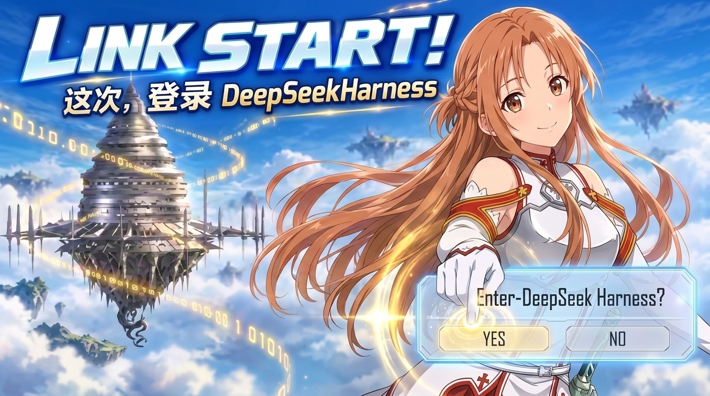

# DSH LinkStart Startup



为 DeepSeek Harness 制作的开场启动器。双击运行，播完开场动画后自动进入 DeepSeek Harness 会话窗口。

---

## 效果

双击后动画窗口立刻占住 DSH 会话窗口的位置，同时在后台把 DeepSeek Harness 启动起来 —— 它的加载过程发生在动画背后。

「Link Start」语音 1.17 秒 → 开场动画 17.43 秒（语言／登录／确认面板、标题渐入、蓝色爆闪）→ 爆闪收尾时淡出 0.7 秒 → 露出已经加载好的 DSH 会话窗口。

**首次运行**会先等 DSH 窗口出现（最多 6 秒）才开始，之后每次都是立刻出现。右上角 **✕** 或 `Esc` 可以随时跳过。

---

## 系统要求

| | |
|---|---|
| 操作系统 | Windows 10 / 11（64 位） |
| 运行时 | **无需安装** —— .NET Framework 4.x 是 Windows 自带的 |
| DeepSeek Harness | 需要已安装并至少登录过一次（否则确认面板显示占位文字） |

启动器体积约 100 KB，不需要管理员权限，不写注册表，不改动 DSH 的任何文件。

---

## 安装

### 1. 解压

把发行包解压到任意目录，例如：

```
D:\DSH LinkStart Startup\
├── DSH LinkStart Startup.exe
├── launcher.json
└── assets\
    ├── intro_dsh.mp4
    ├── link-start.wav
    ├── title.png
    └── dsh.ico
```

### 2. 告诉它 DeepSeek Harness 在哪

打开 `launcher.json`：

- **`DshPath` 留空**（默认）—— 启动器自己按下面的顺序找，找到就用：

  1. 环境变量 `DSH_EXE`
  2. `%LOCALAPPDATA%\Programs\DeepSeek Harness\DeepSeek Harness.exe`
  3. `%ProgramFiles%\DeepSeek Harness\DeepSeek Harness.exe`
  4. `%LOCALAPPDATA%\DeepSeek Harness\DeepSeek Harness.exe`
  5. 启动器 exe 同目录的 `DeepSeek Harness.exe`

- **`DshPath` 填死**（推荐安装位置特殊时使用）—— 写你自己的完整路径：

```json
{
  "DshPath": "D:\\Apps\\DeepSeek Harness\\DeepSeek Harness.exe"
}
```

**注意：JSON 里反斜杠要写两个** `\\`。

**最可靠的办法**找路径：桌面/开始菜单找到 DeepSeek Harness 快捷方式 → 右键 → **属性** → 看「**目标**」→ 完整复制。

改完保存即可，**不需要重新编译任何东西**。启动器会把最终采用（或找不到）的路径写进 `logs\launcher.log`（事件 `dsh-default` / `dsh-missing`）。

### 3. 动画窗口的位置（默认不用管）

**默认行为已经处理好了**：

- **第一次运行** —— 自动找到 DSH 窗口的**客户区**，把位置记到 `geometry.json`
- **之后每次** —— 直接从 `geometry.json` 读，**第一帧就出现在正确位置，不等待**

> 首次运行因为还没有记录，会先等 DSH 窗口出现（最多 6 秒）才开始。DSH 的窗口通常 1 秒内就创建好，所以这个等待一般察觉不到。

#### 想完全跳过检测（可选）

让 DSH 开着，然后运行：

```powershell
.\"DSH LinkStart Startup.exe" --bounds
```

结果写到 `logs\bounds.txt`，把里面的值抄进 `launcher.json`：

```json
"WindowBounds": "fixed",
"WindowLeft": 320,
"WindowTop": 106,
"WindowWidth": 1280,
"WindowHeight": 820,
```

这是 DSH **客户区**的矩形（不含标题栏）。填好之后就**不再检测任何东西**。

代价：以后改了 DSH 窗口大小、换显示器或改缩放比例，都得重新抄一次。

### 4. 运行

双击 `DSH LinkStart Startup.exe`。

想更方便：右键 exe → **发送到 → 桌面快捷方式**，再固定到任务栏或开始菜单。

---

## 配置项

全部在 `launcher.json` 里，**运行时读取，改完直接生效，不用重新编译**。

| 键 | 默认值 | 说明 |
|---|---|---|
| `DshPath` | `""` | DeepSeek Harness 主程序完整路径。留空 = 自动查找（见上） |
| `WindowBounds` | `"auto"` | `"auto"` 首次检测并记住；`"fixed"` 用下面四个值，完全不检测 |
| `WindowLeft` / `WindowTop` | `0` | 仅 `fixed` 模式：窗口左上角（屏幕坐标，单位 DIP） |
| `WindowWidth` / `WindowHeight` | `0` | 仅 `fixed` 模式：窗口尺寸（填 DSH 客户区尺寸） |
| `VideoFit` | `"aspect"` | 动画缩放方式，见下表 |
| `FadeLeadSeconds` | `0.7` | 片尾前多久开始淡出（0.7 → 第 16.73 秒） |
| `FadeOutSeconds` | `0.7` | 淡出时长（0.7 → 第 17.43 秒结束，正好等于片尾） |
| `MatchDshWindow` | `true` | 是否让动画窗口对齐 DSH 窗口。`false` 则占满整个屏幕 |
| `MatchWaitSeconds` | `6.0` | 等待 DSH 窗口出现的上限，超时就用全屏 |
| `ExtraHoldSeconds` | `1.2` | 视频**自然播完**后额外保持的时间。默认淡出与片尾重叠，所以通常用不到 |
| `MaxHoldSeconds` | `25.0` | 硬上限。窗口**上屏后** 25 秒内一定关闭，不会卡死（上屏前最多再等 `MatchWaitSeconds` 找 DSH 窗口）。正常播放最坏 20.6 秒，所以这个上限不会打断正常动画 |
| `AllowSkip` | `true` | 是否允许按 `Esc` 跳过 |

### VideoFit 的四个取值

| 值 | 效果 |
|---|---|
| `"aspect"` | **默认。** 窗口本身做成 16:9 并覆盖 DSH 客户区 —— 画面完整、无裁切、无黑边 |
| `"fill"` | 窗口保持 DSH 尺寸，画面铺满、超出部分裁掉 |
| `"fit"` | 窗口保持 DSH 尺寸，画面完整、上下留黑边 |
| `"stretch"` | 拉伸填满（会变形，一般不用） |

三块面板与视频用**同一条缩放规则**，所以任何模式下都不会和画面错位。

---

## 使用

双击即可，**不需要任何其他操作**。

- 启动器会自己拉起 DeepSeek Harness，不用你手动开
- 如果你已经开着 DSH，它会找到那个窗口并对齐，动画播完淡出后露出的就是它
- 动画期间可以按 `Esc` 或点右上角 **✕** 跳过
- 已经有启动器在跑时，再双击一次不会开出第二个窗口（会记 `already-running` 后立即退出）

---

## 常见问题

### 动画播完了，但 DeepSeek Harness 没启动

**九成是 DshPath 没找到。** 打开 `logs\launcher.log`，如果看到：

```
dsh-missing
```

说明自动查找全落空、而你也没填 `DshPath`。填上完整路径即可。

### 确认面板显示的不是我的账号名

确认面板的名字是启动器自己读出来的（读 `%USERPROFILE%\.dsh\.credentials.yaml` 或 `%DSH_HOME%\.credentials.yaml`，再向 DeepSeek Platform 查询）。显示 `アカウント名未取得` 表示读取失败，常见原因：

- **从没在 DSH 里登录过** → 先在 DSH 里登录一次
- **网络不通 / 被防火墙拦了** → 退回"本地账号"状态，动画依然正常播放
- **凭据过期** → 在 DSH 里重新登录

无论哪种情况，**动画都不会卡住**，只是名字处显示占位文字。单独检查账号（**不会开窗口**）：

```powershell
.\"DSH LinkStart Startup.exe" --check
```

结果写到 `logs\check.txt`。

### 动画窗口的位置或大小不对

- 用了 `"fixed"` → 位置就是你填的四个值，不对就重新跑 `--bounds` 抄新值。改 DSH 窗口大小、换显示器、改缩放比例之后都要重抄。
- 用了 `"auto"` → 位置取自 `geometry.json`（首次运行后生成）。删掉它就会重新检测一次。

### 动画窗口比 DSH 窗口宽 / 画面被裁 / 有黑边

这三件事**只能三选二**，因为 DSH 客户区不是 16:9。以 1280×820 为例：

| `VideoFit` | 窗口尺寸 | 代价 |
|---|---|---|
| `"aspect"` | 1458×820 | 画面完整无裁切，**但比 DSH 宽 178px**（每侧 89px） |
| `"fill"` | 1280×820 | 无溢出，**但画面左右各裁 89px** |
| `"fit"` | 1280×820 | 画面完整、无溢出，**但上下各留 50px 黑边** |

### 淡出之后 DSH 还在加载

说明 DSH 启动比动画慢。把 `FadeOutSeconds` 调小（比如 `0.3`）并把 `FadeLeadSeconds` 保持 `0.7`，让动画多停留一会儿。

### 想看诊断信息

```
logs\launcher.log
```

记录了每个阶段的时刻（`begin` / `geometry` / `show` / `reveal` / `intro` / `film-ended` / `fade-out` / `fade-done`）和所有失败原因。

---

## 从源码构建

> **要改这个项目或重写它，先读 [docs/SPEC.md](docs/SPEC.md)** —— 里面有全部实测数据（帧号映射、面板坐标、渐入曲线、爆闪剖面）、架构决策，以及**已经踩过的每一个坑**。很多坑属于"看起来能跑但功能整块不生效"的类型，不知道会重踩。
>
> 本项目还有 [docs/CONTRACT.md](docs/CONTRACT.md)（接口冻结与验收标准）与两份独立验证报告 [docs/VERIFY-CONFORMANCE.md](docs/VERIFY-CONFORMANCE.md)、[docs/VERIFY-RUNTIME.md](docs/VERIFY-RUNTIME.md)。

源码只有三个 C# 文件，**不需要 Visual Studio、不需要 SDK、不需要 NuGet** —— 直接用 Windows 自带的 `csc.exe` 编译：

```powershell
powershell -ExecutionPolicy Bypass -File build.ps1

# 本机自用：顺手把 DSH 路径写进 out\launcher.json（仓库里的 launcher.json 保持通用，便于分发）
powershell -ExecutionPolicy Bypass -File build.ps1 -DshPath "D:\Apps\DeepSeek Harness\DeepSeek Harness.exe"
```

产物在 `out\`。

| 文件 | 作用 |
|---|---|
| `Launcher.cs` | 窗口、阶段流程、视频与语音播放、窗口对齐、淡出交接、配置、日志、诊断模式 |
| `Panels.cs` | 三块面板的矢量绘制 + 标题渐入曲线 |
| `Account.cs` | 读取 DSH 账号：凭据文件 + Platform 接口 |
| `app.manifest` | 声明 per-monitor DPI 感知（否则高 DPI 下窗口盖不满屏幕） |
| `build.ps1` | 编译脚本，链 WPF 三个程序集并嵌入图标 |

**注意编译器是 C# 5**（`csc.exe` v4.0.30319）。这意味着：

- 不能用 `?.` 空条件运算符（用 `== null ? :` 代替）
- 不能用 `nameof`、字符串插值 `$"..."`、表达式体成员
- 泛型委托的参数类型要和事件签名完全一致，比如 `MediaElement.MediaFailed` 是 `EventHandler<ExceptionRoutedEventArgs>`，不是 `ExceptionEventArgs`

---

## 目录结构

```
dsh-linkstart-startup\
├── README.md
├── LICENSE                     MIT（代码）；素材版权见 LICENSE 末尾说明
├── docs\
│   ├── poster.jpg              宣传图
│   ├── SPEC.md                 实现规格与重构指南（行为与数据的唯一权威）
│   ├── CONTRACT.md             接口冻结与验收标准
│   ├── VERIFY-CONFORMANCE.md   独立验证 A：静态一致性
│   ├── VERIFY-RUNTIME.md       独立验证 B：动态运行与像素
│   └── KNOWN-ISSUES.md         已知问题（含未修项与原因）
├── Launcher.cs                 主程序
├── Panels.cs                   面板与标题绘制
├── Account.cs                  账号读取
├── app.manifest                DPI 感知声明
├── build.ps1                   编译脚本
├── launcher.json               配置（运行时读取）
├── assets\
│   ├── intro_dsh.mp4           开场动画 1920×1080 60fps 17.433s
│   ├── link-start.wav          「Link Start」语音 1.170s
│   ├── title.png               标题图（用于渐入）
│   └── dsh.ico                 图标
└── out\                        编译产物
    ├── DSH LinkStart Startup.exe
    ├── launcher.json
    ├── README.md
    ├── assets\
    ├── geometry.json           首次运行后生成，记住 DSH 窗口位置
    └── logs\
```

---

## 说明

代码以 **MIT** 许可发布（见 `LICENSE`）；`assets\` 里的动画、语音、图标以及 `docs\poster.jpg` 取自 DeepSeek Harness，版权归原作者，**不在 MIT 许可范围内**。
